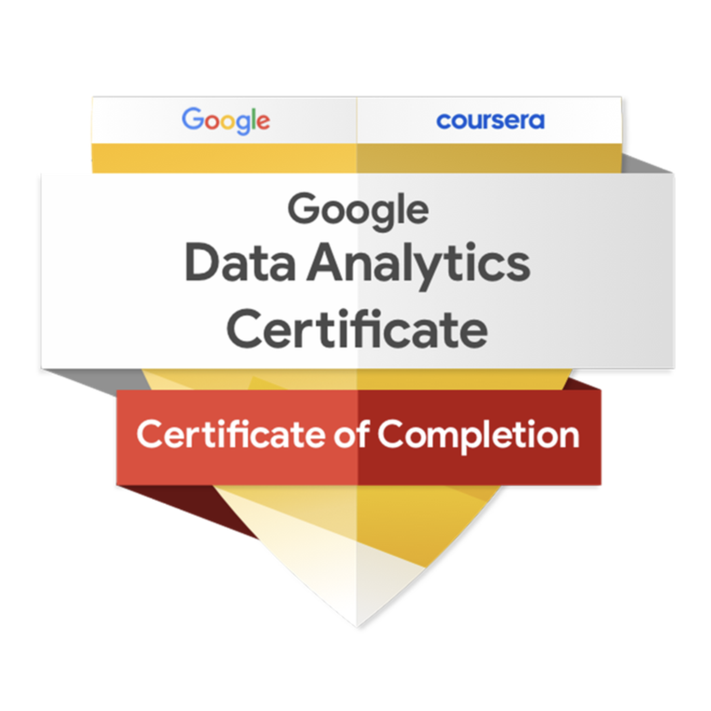

## Sobre mim

Sou **Analista de Dados Júnior** e estou concluindo a graduação em **Engenharia de Software**. Comecei minha trajetória profissional com suporte a sistemas corporativos e automação comercial, o que me deu uma visão prática de processos, bancos de dados e necessidades dos usuários.

Hoje atuo com **Business Intelligence**, desenvolvendo dashboards e indicadores em **Power BI**, realizando transformações com **Power Query**, criando medidas em **DAX** e trabalhando com **SQL, PostgreSQL e integração de APIs REST**.

Tenho interesse em ampliar minha atuação em **análise e engenharia de dados**, com estudos em **Python, estatística e inteligência artificial**. Meu objetivo é desenvolver soluções que sejam tecnicamente consistentes e úteis para decisões de negócio.

## Experiência com Dados e BI

- **Dashboards e indicadores:** desenvolvimento de relatórios para acompanhamento de resultados comerciais, financeiros e operacionais.
- **Preparação de dados:** extração, limpeza e transformação de informações no Power Query, incluindo conexões com bancos de dados e APIs.
- **Modelagem e análises:** estruturação de tabelas e relacionamentos, construção de medidas DAX e consultas SQL.
- **Qualidade e documentação:** investigação de divergências nos dados, validação de indicadores e documentação de fontes, regras de transformação e medidas.
- **Integrações de sistemas:** consumo e testes de APIs REST para consolidar informações de diferentes plataformas, incluindo CRM.

## Tecnologias

### Dados e Business Intelligence

### Integração e ferramentas

### Desenvolvimento de software

Minha formação em Engenharia de Software também inclui projetos e estudos de **desenvolvimento web e back-end**. Embora hoje meu foco profissional seja Dados e BI, essa base contribui para trabalhar com APIs, compreender aplicações e colaborar com equipes de desenvolvimento.

**Em desenvolvimento:** Python para análise de dados, estatística, engenharia de dados e fundamentos de IA.

## Formação e certificações

- **Engenharia de Software** — UNIGOIÁS | Graduação em fase de conclusão.
- **Google Data Analytics Professional Certificate** — Google / Coursera | 2026.
- **Alura** — Power BI: Modelagem de Dados; Power BI: Conceitos do Uso de DAX; SQLite Online: Executando Consultas SQL; Data Storytelling; Git e GitHub.

  

## Portfólio

Estou organizando projetos autorais de análise de dados para apresentar o processo completo — da coleta e modelagem à construção de indicadores e à comunicação dos resultados. Os projetos serão publicados aqui à medida que forem concluídos.

## Contato

- **LinkedIn:** [linkedin.com/in/milena-soares12](https://www.linkedin.com/in/milena-soares12/)
- **E-mail:** [milena.s.oliveira3@gmail.com](mailto:milena.s.oliveira3@gmail.com)
- **Localização:** Goiânia, Goiás — Brasil
